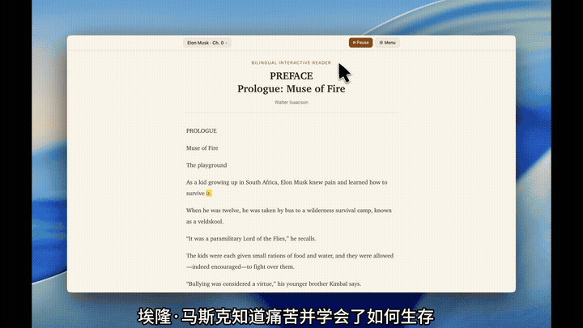
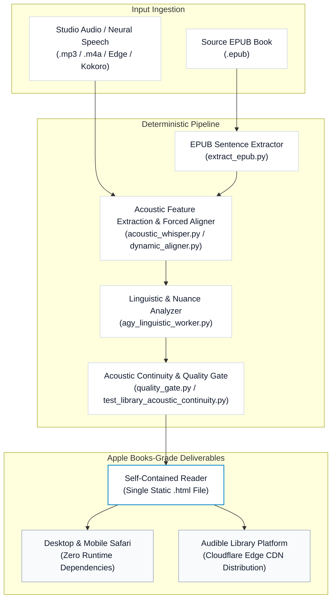

# Interactive Audiobook Reader Pipeline

<p align="center">
  <b>The Apple Books-grade bilingual interactive reader and acoustic synchronization pipeline, engineered natively for macOS and Apple Silicon.</b><br>
  <i>Features EPUB boundary extraction, MLX sub-millisecond forced alignment, interactive shadow typing, single-sentence focus cabins, and cryptographic release gates.</i>
</p>

<p align="center">
  <a href="README.md">简体中文</a> | <a href="README_EN.md"><b>English</b></a>
</p>

<p align="center">
  <a href="https://audiblelibrary.online/books/the-psychology-of-money/"></a>
  <a href="https://apple.com"></a>
  <a href="https://apple.com"></a>
  <a href="https://github.com/ml-explore/mlx"></a>
  <a href="https://github.com/chase-yuan/interactive-audiobook-reader-pipeline"></a>
  <a href="https://github.com/chase-yuan/interactive-audiobook-reader-pipeline"></a>
  <a href="LICENSE"></a>
</p>

---

A deterministic, industrial-strength pipeline for compiling any standard EPUB into a self-contained bilingual reading application. Delivers Apple Books typography, word-level acoustic synchronization, contextual CEFR vocabulary parsing, tactile shadow typing practice, and cryptographic release verification with zero external runtime dependencies.

> [!NOTE]
> Experience the production interactive reader directly in Safari or any modern browser at [audiblelibrary.online](https://audiblelibrary.online/books/the-psychology-of-money/). Zero installation, accounts, or extensions required.

---

## Core Design Philosophy: Why Build This Tool?

This project was born out of a personal exploration into focus, embodied learning, and cognitive learning science during deep bilingual reading:

1. **Dual-Modal Immersion for Laser Focus**: Reading alone often leads to mind-wandering; passive listening often leads to zone-outs. By reading the text while simultaneously listening to studio narration, dual-channel sensory input locks cognitive bandwidth into deep, sustained immersion.
2. **Kinetic Word Tracking as a Visual Anchor**: Real-time highlighting that leaps word-by-word with the audio narration provides an unshakeable visual anchor, completely eliminating the cognitive friction of losing one's place or trailing off.
3. **Pure English Mode: Embracing "Desirable Difficulty"**: By keeping the interface in pure English by default, the brain is deprived of premature crutches. This introduces the cognitive psychological concept of *desirable difficulty*, training the mind to process English directly in context.
4. **On-Demand Bilingual Mode: Dynamic Cognitive Unloading**: Effective learning requires challenge without burnout. The reader allows seamless toggle between pure English and sentence-level bilingual translation on demand, unloading cognitive fatigue during dense chapters.
5. **Interactive Shadow Typing: From Passive Input to Embodied Muscle Memory**: Understanding is not mastery. Through full-keyboard sentence-by-sentence typing while listening, sentence rhythms, idiomatic phrasing, and spelling are anchored directly into physical muscle memory.
6. **Contextual Idiomatic Translation & Nuance Breakdown**: Moving beyond rigid machine translation, nuance cards provide literary-grade idiomatic translations alongside CEFR C1/C2 vocabulary annotations, parts of speech, and phonetic IPA transcripts, helping readers truly absorb vocabulary in its living context.

---

## The Industrial Pipeline Challenge: Why Is This Necessary?

Converting a full-length original English book (often exceeding hundreds of thousands of words across dozens of audio hours) into a publication-grade interactive reader with sub-millisecond audio synchronization encounters severe technical friction when using naive scripts:
1. **Audio and Text Drift**: Narrator pauses, repetitions, breath breaks, and acoustic elisions cause uniform time-slice methods to drift and break alignment within minutes;
2. **Punctuation and Structural Breakage**: Complex abbreviations, nested quotation marks, em-dashes, and hyphenated line breaks frequently shatter sentence boundaries;
3. **Leading and Inter-Sentence Acoustic Voids**: Unindexed chapter introductions, prologues, or omitted body tables cause jarring periods of dead silence during playback;
4. **Heavyweight Runtime Overhead**: Typical web readers depend on bulky Node.js or Electron runtimes, external database services, or live API proxies that fail completely offline.

**This pipeline enforces deterministic, offline, self-contained guarantees:**  
From raw EPUB and studio audio tracks, the system executes pure sentence segmentation, Apple Silicon MLX forced alignment, contextual nuance analysis, and automated acoustic verification, culminating in a single-file, zero-dependency HTML reader.

---

## Interactive Experience & Visual Systems



### 1. Acoustic Word Tracking
Real-time word highlighting locked to studio audiobook narration with sub-millisecond precision, utilizing Apple Silicon Neural Engine acceleration for zero visual jitter.

### 2. Contextual Nuance Cards
Clicking any sentence reveals literary-grade idiomatic translations, CEFR C1/C2 vocabulary annotations, phonetic IPA transcriptions, and grammatical breakdowns.

### 3. Interactive Shadow Typing Practice Engine
- **Tactile Sound Packs**: Four built-in mechanical switch sound profiles (Mechanical Blue switch, Typereader, Bubble, Mute) calibrated for rhythmic typing flow;
- **Zero Layout Shift (CLS = 0)**: Strictly locked word-box physical geometry ensures typing cursor feedback never causes line wraps or layout jitter;
- **Smart Punctuation & Space Auto-Absorption**: Spacebar automatically absorbs trailing sentence punctuation (commas, periods, semicolons) for seamless continuous input;
- **Cloze Active Recall Mode**: Automatically masks high-leverage CEFR vocabulary words to train retrieval memory during audio playback;
- **Mobile Touch Bridge**: Employs zero-width space (`\u200B`) state tracking to provide reliable virtual backspace handling across iOS and iPadOS.

### 4. Single-Sentence Focus Cabin
- **Zero Visual Noise**: Collapses long, dense book layouts into an isolated, high-contrast single sentence cabin;
- **Stepped Font Scaling**: Instantaneous font size adjustment via keyboard shortcuts (`+` / `-`) for ergonomic reading on both high-resolution monitors and mobile screens;
- **Dual-Mode Shortcut System**: Built-in hotkey matrices for both Reading Mode and Typing Mode, accessible at any time via the `?` hotkey modal.

### 5. Apple Books Typography
Native San Francisco and New York serif type stacks, 44px ergonomic touch targets, and instant Light, Warm Sepia, and OLED Dark mode switching.

---

## Apple Silicon Performance

Text extraction, linguistic analysis, and single-file HTML compilation run entirely on Python 3 standard library modules. Speech-to-text forced alignment executes natively via Apple's official `mlx-whisper`, utilizing unified memory, GPU, and Neural Engine acceleration without CUDA container bloat or cloud API latency.

| Execution Target | Audio Duration | Processing Time | Throughput | API Cost |
| :--- | :---: | :---: | :---: | :---: |
| **Apple M5 / M5 Max (Next-Gen Unified Memory)** | 1 Hour (Studio Audio) | **~1.5 min** | **~40x Real-time** | **$0.00 (Offline)** |
| **Apple M4 / M3 Max (Unified Memory)** | 1 Hour (Studio Audio) | **~2.2 min** | **~27x Real-time** | **$0.00 (Offline)** |
| **Apple M3 / M2 Pro** | 1 Hour (Studio Audio) | **~3.5 min** | **~17x Real-time** | **$0.00 (Offline)** |
| **Apple M1 / M2 Air** | 1 Hour (Studio Audio) | **~4.8 min** | **~12x Real-time** | **$0.00 (Offline)** |
| Cloud GPU / REST ASR API | 1 Hour (Studio Audio) | ~6–10 min + Latency | ~7x Real-time | $0.36 – $1.20 / Title |

---

## System Architecture



---

## 30-Second Quickstart

The repository includes a public domain demonstration book (*The Art of War*, English translation). Build a complete interactive reader in 5 seconds:

```bash
# 1. Clone the repository
git clone https://github.com/chase-yuan/interactive-audiobook-reader-pipeline.git
cd interactive-audiobook-reader-pipeline

# 2. Build the interactive bilingual reader (Pure standard library, zero dependencies)
python3 universal_runner.py demo/sample.epub --text-only
```

Upon completion, Safari will automatically launch and display the generated single-file reader.

---

## Production Operational Modes

### Mode 1: Pure Text Bilingual Reader (`--text-only`)
Designed for ebooks without accompanying audio. Automatically performs chapter parsing, sentence alignment, vocabulary analysis, and keyboard navigation:

```bash
# Auto-detect metadata and output to directory
python3 universal_runner.py /path/to/book.epub --text-only

# Enable multi-core parallel analysis (e.g. 8 processes):
python3 universal_runner.py /path/to/book.epub --text-only --concurrency 8 --book-dir ./my_book
```

### Mode 2: Studio Audio Interactive Reader (`complete`)
Combines standard EPUB text with professional studio audiobook recordings (`.mp3` or `.m4a`), using Apple Silicon MLX Whisper for word-level alignment:

```bash
# Install Apple Silicon native MLX acoustic dependencies
pip install -e '.[acoustic]'

# Build complete interactive audiobook reader
python3 universal_runner.py --epub /path/to/book.epub --audio-dir /path/to/mp3s --book-dir ./my_book
```

### Mode 3: Autonomous Neural Speech Synthesis (Dual Neural TTS)
For ebooks without commercial studio recordings, the pipeline offers two neural speech synthesis backends:
- **Microsoft Edge HD Neural TTS**: Broadcast-quality multilingual speech (`BrianMultilingualNeural` by default) with concurrent streaming acceleration;
- **Local Kokoro-82M ONNX**: Runs 100% offline with zero GPU heat, delivering natural cadence and precise word-level alignment timestamps.

```bash
# Generate natural neural audio and compile interactive reader
python3 universal_runner.py /path/to/book.epub --book-dir ./my_book
```

---

## Global CLI Installation

Install into your local Python environment to use the `reader-build` entrypoint across any terminal session:

```bash
# Core installation (Pure text reader compiler)
pip install -e .

# Full installation (Includes Apple Silicon MLX acoustic engine and deployment tools)
pip install -e '.[acoustic,deployment]'
```

Once installed, build directly from any location:

```bash
reader-build /path/to/book.epub --text-only
```

---

## Resource Layout & Audio Mapping Specification

The pipeline follows a strict chapter prefix and audio track contract:

```text
my_book_sources/
  book.epub
  audio/
    00_preface.mp3
    01_chapter1.mp3
    02_chapter2.mp3
```

The orchestrator validates monotonicity using numerical prefixes or EPUB spine identifiers, eliminating missing tracks or out-of-order sequences.

---

## Cryptographic Quality Gates & Verification Framework

Before any title can be published, it must pass strict physical quality gates enforced by `quality_gate.py` and `validate_outputs.py`:
- **Stage 1.5 Shift-Left Sentence Gate**: Validates hyphenation stitches, capitalization continuity, and quote pairing prior to expensive LLM and TTS passes;
- **Red-Team Acoustic Continuity Dual Gate**: Built-in test auditor `test_library_acoustic_continuity.py` enforces a leading speech gap threshold of `≤ 4.0s` and an inter-sentence void threshold of `≤ 6.0s`, scanning full book libraries in seconds to eliminate audio blind spots;
- **Cryptographic ReleaseToken**: Issued only when acoustic coverage is ≥ 95%, timestamps are strictly monotonic, and translation records are complete;
- **Tamper-Proof Verification**: HTML compilation requires an authentic ReleaseToken, strictly blocking unverified intermediate builds;
- **Automated Regression Suite**: Comprehensive test suite covering 270 assertions:

```bash
python3 -m unittest discover -v
```

---

## Repository Directory Manifest

- `universal_runner.py`: Main executable entrypoint (`reader-build`) supporting all three production modes
- `extract_epub.py`: EPUB sentence boundary extractor with paragraph stitching and de-hyphenation
- `edge_synthesizer.py`: Microsoft Edge-TTS broadcast-grade neural synthesis adapter
- `kokoro_synthesizer.py`: Lightweight 82M Kokoro ONNX neural speech synthesizer with multi-threaded chunking
- `dynamic_aligner.py`: High-precision dynamic time warping acoustic aligner with backward token inspection
- `html_builder.py`: Apple Books-grade self-contained single-file HTML compiler
- `build_prototype.py`: Compiler injector for Interactive Shadow Typing and Single-Sentence Focus Mode
- `content_profile.py`: Pipeline mode orchestrator (`text_only` vs `complete` vs `synthetic`)
- `quality_gate.py`: Cryptographic release gate and Stage 1.5 sentence integrity validator
- `test_library_acoustic_continuity.py`: Red-team acoustic continuity automated library auditor
- `validate_outputs.py`: Release artifact invariant and schema validator
- `acoustic_whisper.py`: Apple Silicon MLX Whisper word-level feature extractor
- `demo/sample.epub`: Public domain demonstration EPUB
- `docs/images/`: Interactive reader animated demonstrations and assets
- `setup.py`: Python package configuration and console entrypoint definitions
- `LICENSE`: MIT Open Source License

---

## License

This project is licensed under the [MIT License](LICENSE).
